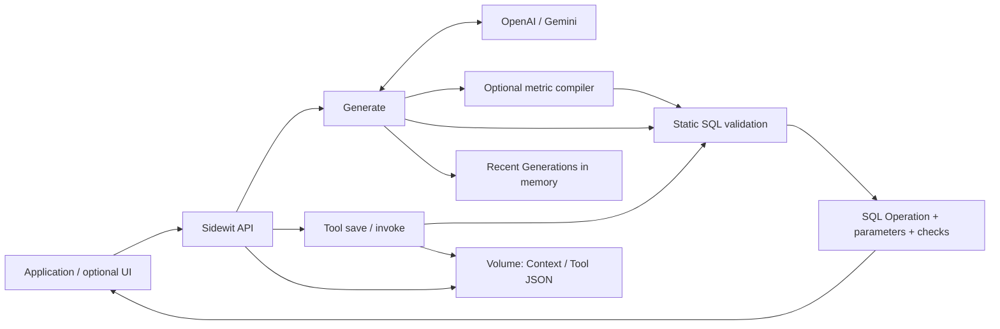

# Sidewit

**An AI agent that transforms natural-language queries into executable operations for your applications**

Sidewit currently supports PostgreSQL operations. It reuses saved Tools and generates SQL drafts from schema and business context for uncovered parts of a request. You can save reviewed SQL as reusable Tools. It runs with **one API container and a data directory—no database server required**. The management UI is optional.

Sidewit is not a database proxy: it never connects to a database or executes SQL. Generate uses an LLM and requires review. Saved Tools return the same Operation for the same contract and inputs without an LLM call. Your application decides whether and how to execute it.

**Status: v0.1 release candidate.** [Quick Start](#quick-start) · [Configuration](#configuration) · [API example](#api-example) · [Limitations](#limitations-and-roadmap)

## Features

| Feature | What it does |
|---|---|
| Context | Manage schemas, relations, descriptions and business rules; import DDL |
| Generate | Select a matching saved Tool first; otherwise produce SQL drafts, or return `ambiguous` / `unanswerable` |
| Tool plans | Return 1–5 independent operations, reusing saved Tools and generating uncovered parts |
| Static validation | Check statement type, Context tables and columns, parameter contracts, and supported value policies |
| Tools | Save, rename and edit reviewed SQL and input contracts; enable/disable reuse; revalidate after Context changes; invoke deterministically |
| SQL metric contracts | Compile registered aggregates, joins, fixed filters and periods into SQL |
| Management UI | Edit Contexts, review generated Operations, save and invoke Tools |

Use **Enable/Disable** in the Tools list or editor to keep a Tool without using it. Disabled
Tools are excluded from automatic selection and direct invocation. Re-enabling checks the
current Context; new Tools are enabled by default. Context policy still controls new SQL generation.

## Architecture



Contexts and Tools persist in `./data` by default and survive container replacement. Run **one API process per data directory**. Generation history keeps the most recent 200 records by default, in memory only, and is lost on restart. Stop the API before backups or manual file edits; see [deployment and recovery](docs/DEPLOYMENT.md).

Built with Python 3.12, FastAPI, Pydantic and SQLGlot; React, TypeScript and Vite; Docker Compose.

## Quick Start

Requires Docker Engine/Desktop and **Docker Compose v2** with `--wait` support. No local Python or Node.js installation is needed. On Windows, use Docker Desktop's WSL 2 backend with Linux containers and run these commands in a WSL terminal; keep the project and data in the WSL Linux filesystem (see [desktop platforms](docs/DEPLOYMENT.md#desktop-platforms)). Run from the repository root:

```bash
cp .env.example .env
```

Add one of the [provider configurations](#configuration) below to `.env`, then start Sidewit:

```bash
docker compose up -d --build --wait
curl -fsS http://127.0.0.1:8000/api/v1/health
```

1. Open the UI at **http://127.0.0.1:3000** and sign in. The default web administrator is **`admin` / `admin`**; set `SIDEWIT_ADMIN_USERNAME` and `SIDEWIT_ADMIN_PASSWORD` in `.env` to change it. Interactive API documentation is at http://127.0.0.1:8000/docs.
2. Register the example Context. This previews the DDL, adds descriptions and business rules, and saves the result without calling an LLM:

   ```bash
   docker compose run --rm -T --no-deps -v ./examples/ecommerce:/examples:ro api python /examples/quickstart.py --context-only
   ```

3. In Playground, select `ecommerce`. Use the bundled question **최근 30일 서울 지역 매출 알려줘** (“Show revenue for the Seoul region over the last 30 days”), set reference time to `2026-10-02T09:00:00+09:00`, and click **Generate operation**.
4. If the status is `ok`, review the SQL, parameters and validation result. A **saved Tool** result links to the reused Tool. For a new draft, choose **Create Tool draft**, review the inputs and SQL, then **Save tool**.
5. Enter arguments under **Invoke Tool**. The result is **SQL and binding values**, not database query results.

Without a provider key, you can still manage Contexts, import DDL, and manually save and invoke Tools. Generate returns `503 llm_not_configured` when no provider is configured. The [ecommerce walkthrough](examples/ecommerce/README.md) also covers manual Context setup in the UI.

The `.env` file is optional for a local trial: without it, the web UI starts with `admin/admin`
and no LLM provider. There is no forced password-change screen. The administrator is configured
entirely through environment variables; there is no signup flow, account database or web password
editor. See [web login and recovery](docs/DEPLOYMENT.md#web-login-and-recovery).

To run without the UI, use `docker compose up -d --build --wait api`. Stop with `docker compose down`; the data directory remains on disk.

## Configuration

Compose reads the root `.env` file. Keep real keys and user data out of the repository and images. Choose **one** provider configuration:

```dotenv
# OpenAI
SIDEWIT_LLM_PROVIDER=openai
SIDEWIT_LLM_MODEL=gpt-6-luna
OPENAI_API_KEY=<your-openai-api-key>
```

```dotenv
# Gemini
SIDEWIT_LLM_PROVIDER=gemini
SIDEWIT_LLM_MODEL=gemini-3.1-flash-lite
GEMINI_API_KEY=<your-gemini-api-key>
```

See the [evaluation summary](evals/README.md#file-storage-acceptance-2026-10-12-kst) for real-provider integration results and known value-translation failures. Apply configuration changes with `docker compose up -d --wait`.

| Variable | Purpose | Default |
|---|---|---|
| `SIDEWIT_DATA_PATH` | Host data directory mounted at `/data` | `./data` |
| `SIDEWIT_API_PORT` / `SIDEWIT_WEB_PORT` | Local API / UI ports | `8000` / `3000` |
| `SIDEWIT_API_KEY` | Sidewit Bearer authentication | Disabled when unset |
| `SIDEWIT_ADMIN_USERNAME` | Web administrator username | `admin` |
| `SIDEWIT_ADMIN_PASSWORD` | Web administrator password | `admin` |
| `SIDEWIT_ADMIN_COOKIE_SECURE` | Require HTTPS for the web session cookie | `false` for local HTTP |
| `SIDEWIT_GENERATION_HISTORY` | Maximum number of recent Generations in memory | `200` |

### API authentication

When `SIDEWIT_API_KEY` is set, public `/api/v1` requests other than health checks require
`Authorization: Bearer <sidewit-api-key>`. This is separate from the provider key and grants
management, generation and invoke access; do not distribute it to end users. Web login uses an
HttpOnly session cookie and does not require entering or storing the API key in the browser.
The web UI calls session-protected `/api/web/v1` routes; application clients keep using `/api/v1`.
Without `SIDEWIT_API_KEY`, the public API remains unauthenticated even though the web UI requires
login. Default ports bind to loopback only. Before allowing remote access, change the default
admin credentials, configure a nonempty API key and HTTPS, and set `SIDEWIT_ADMIN_COOKIE_SECURE=true`.
See the [security policy](SECURITY.md).

## API example

The base path is `/api/v1`. This command makes real LLM calls and runs **Context → DDL import → Generate → Tool draft → Save → Invoke**:

```bash
docker compose run --rm -T --no-deps -v ./examples/ecommerce:/examples:ro api python /examples/quickstart.py
```

| Step | Request | Input / result |
|---|---|---|
| Create Context | `POST /contexts` | Schema, descriptions and rules from [context.json](examples/ecommerce/context.json) |
| Preview DDL | `POST /contexts/{id}/import-ddl` | [schema.sql](examples/ecommerce/schema.sql) → `context_version`, `definition`, `warning_details` |
| Save Context | `PUT /contexts/{id}` | Review the preview; send the complete Context and `expected_version` |
| Generate SQL | `POST /generate` | Context ID, question and reference time → Operation draft |
| Draft Tool | `POST /tools/draft` | `generation_id` + `step_id` (optional for one step) → SQL and input contract |
| Save Tool | `POST /tools` | Review the draft and omit `example_arguments` before saving |
| Invoke | `POST /tools/{tool_id}/invoke` | `arguments` → SQL, binding values, versions and validation result |

Use the saved Tool's `id` for resource URLs. Renaming changes its label and version while
its UUID and API/UI addresses stay the same; names are never used as resource addresses.

Example Generate request, using the bundled Korean-language fixture:

```json
{
  "context_id": "<created-context-id>",
  "question": "최근 30일 서울 지역 매출 알려줘",
  "reference_time": "2026-10-02T09:00:00+09:00"
}
```

Every successful Generate response has an `operations` array, including a single result.
Read each step's `operation`, `validation` and `source`. An illustrative `operations[0].operation` follows. This is an authored example, not a real model response. `서울` is the fixture's exact value for Seoul.

```json
{
  "type": "sql",
  "dialect": "postgresql",
  "statement": "SELECT SUM(o.amount) AS revenue FROM orders o JOIN customers c ON c.id = o.customer_id WHERE c.region = :region AND o.status = 'COMPLETED' AND o.paid_at >= :start_at AND o.paid_at < :end_at",
  "parameters": {"region":"서울","start_at":"2026-09-02T09:00:00+09:00","end_at":"2026-10-02T09:00:00+09:00"},
  "parameter_types": {"region":"string","start_at":"date-time","end_at":"date-time"}
}
```

For `ambiguous`, show `clarification_questions` as choices or a free-text input, then send the
returned `continuation_request` with the user's answers added. See
[API integration](docs/API_USAGE.md) for a short client example and
[continuing a request](docs/CLARIFICATIONS.md) for the full contract.
For `unanswerable`, check whether the Context contains the required data. Neither status provides an Operation to execute.

Example input to the saved Tool's invoke endpoint:

```json
{"arguments":{"region":"서울","start_at":"2026-09-02T09:00:00+09:00","end_at":"2026-10-02T09:00:00+09:00"}}
```

Invoke does not call an LLM or execute SQL. Your application must adapt `:name` placeholders to its driver and bind values. **Never interpolate values into SQL strings.** See the [API contract](docs/SPEC.md#5-api) for complete request, response and version-conflict details.

### Saved Tool selection

By default, `POST /generate` asks the model to select 1–5 saved Tool calls from the same Context and extract
their arguments. The catalog includes the Tool's SQL and input schema, so selection is based on
its whole operation rather than just its name. A match invokes the existing deterministic Tool
service; it never executes SQL. The response uses `source: "plan"` and an `operations` array with per-step
`selected_tool: {"id": "uuid", "name": "...", "version": 1}`. Review the selected Tools and arguments: static
validation cannot prove that they answer the question.

If Tools cover only part of the question, the existing metric/SQL generation path fills the gaps.
If no Tool matches, generation handles the whole question. Missing inputs or ambiguous
intent return clarification questions. Invalid selections, incompatible Tools and concurrent
Tool/Context changes fail explicitly; they do not silently fall back to new SQL. Requests with
explicit metric options (`metric_id`, `date_field`, `period`, or `require_metric: true`) skip Tool
selection and use the metric path. With no saved Tools, there is no extra model call.

Natural-language selection requires an LLM call; direct `/tools/{tool_id}/invoke` still does not.
Selection and generation share the 90-second request deadline. Catalogs over 100,000 serialized
characters are rejected with `tool_catalog_too_large` rather than silently truncated. New drafts are saved only when you explicitly create a Tool.

### SQL metric contracts

Register reviewed aggregates under `definition.metrics` for recurring queries. The model selects a metric, inputs and period; the server compiles the SQL. If no metric fits, the model can write SQL instead. Set `allow_generated_sql: false` on the Context to disable new model-written SQL; saved Tools can still be selected. Set `require_metric: true` on a request to bypass Tool selection and require the metric path. **Contract compilation does not prove that the model chose the right metric or values.** See [metric contracts](docs/METRIC_CONTRACTS.md) for the format, examples and Tool rebuild behavior.

## Evaluation and development checks

Run regression evaluations against a running API with a real provider configured. External API charges apply.

```bash
docker compose run --rm -T --no-deps -v ./evals:/evals:ro api sidewit-eval run /evals/commerce --api-url http://api:8000
```

The suites are **regression cases exposed during development and review**, not a general NL2SQL accuracy benchmark. FakeProvider results do not measure real-model accuracy either. See [evaluation guidance](evals/README.md) for suites and result summaries, and [contributing](CONTRIBUTING.md#development-checks) for lint, test and build commands. Development parity tests use a temporary PostgreSQL instance; the product does not need one.

## Limitations and roadmap

- Only PostgreSQL SELECT-family SQL and named `:name` parameters are supported. Other Operation types, database connections, SQL execution, dependent Tool chaining and Vector/RAG/MCP are not implemented.
- Static validation does not guarantee executability, absence of side effects, execution cost or business correctness. The application must enforce database roles and function privileges, user and tenant authorization, and time/resource limits. Prose business rules and omitted conditions are not automatically enforced.
- One API process owns a data directory on a local filesystem. Multiple instances are not supported. Once a Generation leaves memory, it cannot be used to create a Tool draft.
- All Tool inputs are required. Optional/default/array inputs and Tool version history are not supported. Generate has a 90-second total request budget, including repair.
- Questions, Context content and the same Context's saved Tool catalog (including SQL and input schemas) are sent to the selected provider. Generation content stays in memory, but saved Tool SQL and Context values persist in files. Protect the data directory and backups.

The [specification](docs/SPEC.md) defines supported expressions and input limits. Future work will be driven by usage of the SQL and Tool workflow; no additional Operation types are scheduled.

## Documentation

| Document | Use it for |
|---|---|
| [Deployment and recovery](docs/DEPLOYMENT.md) | Server configuration, backups, recovery, write failures and upgrades |
| [API and validation contract](docs/SPEC.md) | Request/response models, versions, validation boundaries and storage contracts |
| [SQL metric contracts](docs/METRIC_CONTRACTS.md) | Metric definitions, period calculation and Tool binding |

Documentation and specifications are in English. Example values retain their original spelling.

[Apache-2.0](LICENSE) · [Contributing](CONTRIBUTING.md) · [Security](SECURITY.md) · [Changelog](CHANGELOG.md)

### SQL function policy

SQL validation uses a [closed function allowlist](docs/SQL_FUNCTIONS.md), including
for saved Tools. Unknown or schema-qualified functions are rejected. To use supported
spatial functions, enable **Allow supported PostGIS functions** in the Context editor,
or set definition.sql_extensions to ["postgis"]. Sidewit does not install PostGIS.

After upgrading, review and revalidate existing Tools: previously accepted functions or
escape/Unicode string literals may now fail validation. Database privileges, a trusted
search_path and execution limits remain your application's responsibility.


### Multiple saved Tools

Just submit a question in the Playground or to `POST /api/v1/generate`; no mode is needed.
Sidewit automatically selects one or more saved Tools covering the whole request and returns
all validated operations together. The same Tool can be selected with different inputs.
If saved Tools cover only part of the request, new SQL or metric operations fill the gaps in
the same plan. All operations must validate; a failure or clarification returns no partial plan.
Generated steps can be saved individually as Tools. Applications must
read `operations` for every successful response, regardless of source or operation count. See [Tool plans](docs/TOOL_PLANS.md).
